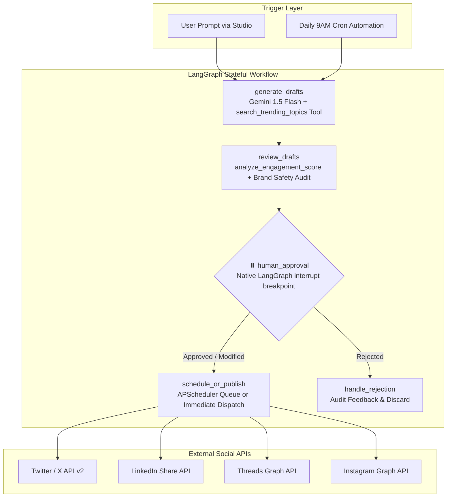

# 🚀 OmniPost.AI — Autonomous Social Media Agent with Human-in-the-Loop (HITL)

[](https://python.org)
[](https://fastapi.tiangolo.com)
[](https://langchain.com)
[](https://ai.google.dev)
[](https://opensource.org/licenses/MIT)

> An autonomous multi-platform social media agent built with **LangGraph**, **FastAPI**, **Google Gemini**, **OAuth 2.0 API Connectors**, and **APScheduler Cron Automation**, featuring native **Human-in-the-Loop (HITL)** approval workflows.

---

## 🌟 Key Architecture



---

## ✨ Core Capabilities

* **Stateful LangGraph Workflow**: Built with `StateGraph`, `MemorySaver`, and native `interrupt()` breakpoints that freeze pipeline state until a human operator approves, modifies, or rejects drafts.
* **Platform-Tailored Content**:
  * **Twitter/X**: Punchy hooks, character limits (<280), optimal hashtag density.
  * **LinkedIn**: Professional story format with structured takeaways and spacing.
  * **Instagram & Threads**: Engaging community questions with high-virality hooks.
* **Intelligent Tool Calling (`@tool`)**:
  * `search_trending_topics`: Scans breakout discussions and hashtag volumes.
  * `analyze_engagement_score`: Heuristic algorithm scoring hook power (0–100).
  * `publish_to_social_api`: Connects to social network APIs with OAuth rate-limit tracking.
* **APScheduler Cron Automation**:
  * Periodic background worker dispatches scheduled posts precisely on time.
  * Recurring automated campaign triggers content research on schedule.
* **Glassmorphic Control Dashboard**:
  * Real-time LangGraph visualizer displaying active node execution.
  * Human approval queue with side-by-side platform previews.
  * One-click "Approve & Publish", "Approve & Schedule", or "Inline Edit".

---

## 📁 Repository Structure

```
ai-social-media-agent/
├── app/
│   ├── __init__.py
│   ├── main.py          # FastAPI server, endpoints & static mounting
│   ├── graph.py         # LangGraph state graph with HITL interrupt()
│   ├── tools.py         # LangChain @tool definitions with audit logging
│   ├── scheduler.py     # APScheduler background workers & cron jobs
│   ├── storage.py       # SQLite database layer for posts and checkpoints
│   └── config.py        # Environment settings & OAuth config
├── static/
│   ├── index.html       # Modern responsive glassmorphic dashboard
│   ├── css/style.css    # Curated dark mode design system
│   └── js/app.js        # Interactive visualizer, queue & scheduling logic
├── tests/
│   └── test_agent.py    # Unit & integration test suite
├── .env.example         # Configuration template
├── .gitignore           # Python, secrets, and SQLite ignore rules
├── Dockerfile           # Production container configuration
├── docker-compose.yml   # Single-command container deployment
├── requirements.txt     # Locked production dependencies
├── run.bat              # Windows one-click launcher
├── LICENSE              # MIT Open Source License
└── README.md            # Comprehensive project documentation
```

---

## ⚡ Quickstart Guide

### Option 1: Local Setup

1. **Clone the repository:**
   ```bash
   git clone https://github.com/abhijaylg09/ai-social-media-agent.git
   cd ai-social-media-agent
   ```

2. **Install dependencies:**
   ```bash
   pip install -r requirements.txt
   ```

3. **Configure environment variables (Optional):**
   ```bash
   cp .env.example .env
   ```
   Add your Gemini API key:
   ```env
   GEMINI_API_KEY=your_gemini_api_key_here
   DEFAULT_MODEL=gemini-1.5-flash
   ```
   *(Note: The system includes smart template generation and works out-of-the-box even without an API key!)*

4. **Launch the server:**
   * On Windows: double-click `run.bat` or run:
     ```bash
     python -m uvicorn app.main:app --host 127.0.0.1 --port 8000 --reload
     ```
   * Open **[http://127.0.0.1:8000](http://127.0.0.1:8000)** in your browser.

---

### Option 2: Docker Setup

```bash
docker-compose up --build
```
Open **`http://localhost:8000`** in your browser.

---

## 🧪 Running Automated Tests

```bash
python -m unittest discover tests
```

---

## 📡 REST API Reference

| Method | Endpoint | Description |
| :--- | :--- | :--- |
| `POST` | `/api/generate` | Starts LangGraph pipeline; stops at human approval breakpoint |
| `GET` | `/api/posts` | Lists all posts (filter by `status=pending`, `scheduled`, `published`) |
| `GET` | `/api/posts/{thread_id}` | Retrieves full state and execution history trace for a thread |
| `POST` | `/api/posts/{thread_id}/resume` | Resumes paused graph with human decision (`approved`, `modified`, `rejected`) |
| `POST` | `/api/posts/{post_id}/publish-now` | Forces immediate dispatch of scheduled post via tool calling |
| `GET` | `/api/tools/logs` | Fetches tool calling audit trail |
| `POST` | `/api/cron/trigger-campaign` | Manually triggers the recurring trend research campaign |
| `POST` | `/api/settings` | Updates Gemini API key and model selection dynamically |

---

## 📄 License

Distributed under the **MIT License**. See [`LICENSE`](LICENSE) for details.
